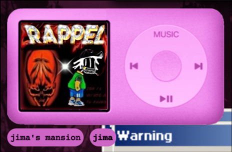

# mpd_coverwall

THIS IS A WORK IN PROGRESS

QuickShell mp3 player widget that displays the album art of the currently playing
[`mpd`](https://www.musicpd.org/) song. Currently it looks for embedded art
first, and then falls back to a file with a name containing `folder` or `cover`
in the same folder as the music file.




## Dependencies

`mpd, qs, ffmpeg`

# AUTOMATED INSTALL SCRIPT

#### Recommended if you just want to install the widget and use it without checking how it works

(Note: This method requires having curl installed)
```
cd
curl -o install.sh https://raw.githubusercontent.com/AR4eL974/mpd_quickshell_widget/refs/heads/master/install.sh
chmod +x install.sh
./install.sh
```

# NO AI IN THIS CODE
This code has been made without the use of any generative AI because the author is deeply concerned by the effect AI has on our society and our planet, any modifications by contributors who use generative AI will NOT be accepted.
